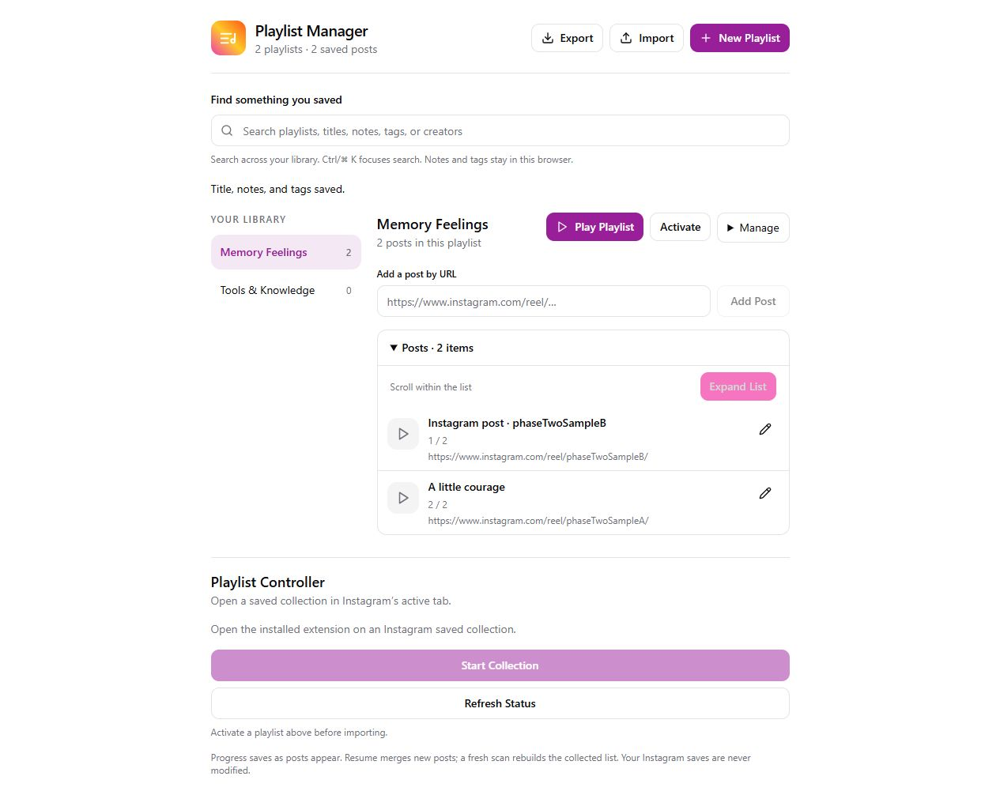

# Instagram Video Playlist

**Return to something you saved.** A Chrome extension for turning Instagram saved collections into searchable playlists.

I built this because my saved posts had become difficult to revisit. Some were practical references: tools, tips, and things to learn. Others captured a feeling I wanted to return to. Playlists let me choose that content deliberately instead of scrolling until I find it again.



*Library preview with demonstration data. Videos play on Instagram; the extension stores references and personal metadata.*

## Features

- Collect links from an individual saved collection, with saved progress and resume support.
- Organize playlists and search personal titles, creators, captions, notes, and tags. Queue results explain what matched.
- Edit metadata, move directly to a queue position, and remove posts through the editor.
- Control playback on Instagram using a floating queue, shuffle, previous/next, pause, and sound controls.
- Turn **Autoplay next post** on to advance through the queue, or off to loop the current reel natively without reloading it.
- Export and import playlists as JSON. Your library stays in your browser.

## Install from source

Requires desktop Chrome 116 or later, Node.js 22 or later, and npm. Sign into Instagram in Chrome before collecting or playing saved posts. The extension is not yet listed in the Chrome Web Store.

```sh
git clone https://github.com/ihassanrayan-max/insta-saved-playlist.git
cd insta-saved-playlist
npm ci
npm run build
```

Open `chrome://extensions`, enable **Developer mode**, choose **Load unpacked**, and select the repository's `dist` folder.

After rebuilding, click **Reload** on the extension card and refresh Instagram. Open tabs otherwise keep the previous content script.

## Use it

1. Open the extension, create a playlist, select it, and choose **Activate**.
2. In Instagram, open Saved and enter one collection. Keep that Instagram tab selected when opening the extension.
3. Under **Playlist Controller**, choose **Start Collection**. You can stop and resume; progress is saved in batches.
4. When collection stops, choose **Import ... Posts** to add results to the active playlist. Re-importing deduplicates existing post references.
5. Click an entry to open it, or choose **Play Playlist**. Use the floating player to control the video and queue.
6. Add titles, notes, tags, or a queue position through **Edit**. Use **Export** to keep a portable copy of your library.

**Sound:** Opening a post, advancing the queue, resuming through the extension, or restoring a managed post after reload starts with sound enabled. Manual mute applies to the current post. An explicit pause survives reload. Chrome may require a click before allowing audible playback; the player reports that condition.

**Autoplay:** On advances to the next item and stops at the end of the queue. Off keeps the playlist active and uses native looping for the current reel. Previous/next and queue selection remain available in either mode. The preference is retained for that tab's playlist during the browser session.

**Keyboard:** `Alt+Shift+Left/Right` changes posts. Focus the player handle and use arrow keys to move it; hold Shift for larger steps, or press Enter to reset its position. Library search uses `Ctrl/Cmd+K`.

## How it works

The popup manages playlists. An Instagram content script collects links from the loaded collection grid and controls the visible video. A background service worker serializes playlist writes and routes playback requests to the Instagram tab.

Collection traverses Instagram's lazy-loaded grid rather than opening every video. Each batch is checkpointed. Resuming scans from the top and merges by shortcode, avoiding dependence on a stale scroll offset.

Playback uses an existing Instagram link when possible and falls back to loading the post's page. Queue state is saved before navigation. Both `/reel/` and `/reels/` routes resolve to the same post. Instagram-specific DOM assumptions live in `src/instagram/adapter.ts`.

The library uses `chrome.storage.local`; tab playback state uses `chrome.storage.session`. There is no custom backend, account service, or analytics. The development page is a library preview, not a separate Instagram player.

```text
src/components/    Playlist manager, collection controls, floating player
src/instagram/     Instagram adapter, collection, navigation, media control
src/utils/         Extension messaging and storage clients
public/            Manifest, worker, repository, validation, session helpers
tests/             Regression tests and disposable browser fixtures
```

React, TypeScript, Vite, Tailwind CSS, and a small set of Radix UI primitives provide the interface. Runtime code is packaged with the extension.

## Development

```sh
npm run dev       # Library preview at http://localhost:8080
npm test          # Storage, collection, routing, media, and lifecycle regressions
npm run lint
npm run build     # Typecheck, build, and validate the extension package
```

See [TESTING.md](TESTING.md) for the Instagram smoke test and browser fixtures. Simulated media tests do not establish real audible playback or continued Instagram compatibility.

Commit working changes in focused chunks after their relevant checks pass. Run the full checks and inspect the diff before pushing. Preserve real dates and existing history; exclude generated builds, credentials, and personal libraries.

## Scope and limitations

- Desktop Chrome extension only. No mobile app or cross-device sync.
- Original posts must remain accessible to the signed-in Instagram account. Deleted or restricted posts may fail to load.
- Collection sees only what Instagram loads. A visible end does not guarantee every saved post was exposed; resume if more appear.
- Page transitions and buffering depend on Instagram and your connection. The readiness indicator reports one observed transition, not a speed guarantee.
- Instagram can change its markup or media behavior. Reload Instagram after extension updates.
- Notes and exports may contain personal information. Review an export before sharing it.

Read the [privacy policy](PRIVACY.md). Publication requirements are tracked in [CHROMEWEBSTORE.md](CHROMEWEBSTORE.md).

## Feedback and license

Report bugs through [GitHub Issues](https://github.com/ihassanrayan-max/insta-saved-playlist/issues), with your Chrome version and reproduction steps. Do not include credentials, cookies, or private exports.

[MIT](LICENSE). Independent project; not affiliated with or endorsed by Instagram or Meta.
